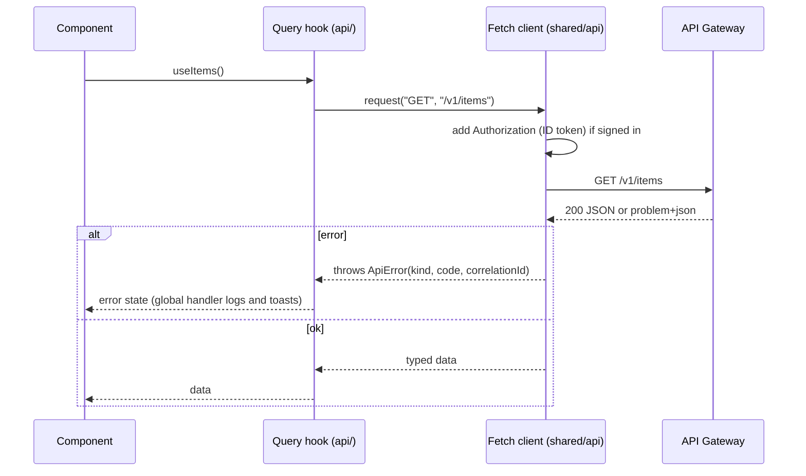

# API client

This document describes how the client talks to the backend: the transport, authentication, error handling,
and every endpoint the application calls, with schemas and examples. The contracts themselves are the
backend's OpenAPI files (`diploma-growpath-backend/contracts/openapi/*.yaml`); the client's types are generated
from them with `npm run gen:api` into `src/shared/api/schema/`.

## Transport

- Every product request goes through the **API Gateway** of the backend, never to a service directly.
- The client calls relative paths such as `/v1/items`. They resolve against the page origin. In development and
  preview, Vite proxies `/v1` to the gateway stage (`VITE_GATEWAY_PROXY_TARGET`); in the deployed build one
  CloudFront origin serves both the application and `/v1`. The browser therefore sees a single origin and the API
  needs no CORS.
- The base address is configuration, not a constant: the LocalStack API id changes whenever LocalStack is
  recreated.
- Only two other network destinations exist: Cognito (sign-in, token refresh) and the presigned URL that the
  backend returns for a photo upload.



## Authentication

Sign-in uses Amazon Cognito's `InitiateAuth` with the `USER_PASSWORD_AUTH` flow, called with a plain `fetch`
(no SDK):

```http
POST {VITE_COGNITO_ENDPOINT}
Content-Type: application/x-amz-json-1.1
X-Amz-Target: AWSCognitoIdentityProviderService.InitiateAuth

{"AuthFlow":"USER_PASSWORD_AUTH","ClientId":"<client id>","AuthParameters":{"USERNAME":"<email>","PASSWORD":"<password>"}}
```

- The **ID token** is sent as `Authorization: <ID token>` on every gateway request. The gateway verifies it and
  sets `X-User-Id`, `X-User-Groups` and `X-Correlation-Id` itself; the client never sends or trusts those headers.
- The session (ID token, refresh token, e-mail and groups read from the ID token for display and routing) lives in
  `sessionStorage`: it survives a page reload and ends with the tab. The password is never stored.
- A token that is about to expire is renewed with `REFRESH_TOKEN_AUTH`. Concurrent requests share one refresh. If
  the refresh fails the session is cleared.
- A visitor sends no `Authorization` header. A `401` for a visitor is expected and is not announced as an error.

## Errors

The backend answers errors as RFC 7807 `application/problem+json`; the gateway answers its own `401` and `403`
as `{"message": "..."}`. The client accepts both and turns every failure into one `ApiError`:

| Field               | Meaning                                                                                                                          |
| ------------------- | -------------------------------------------------------------------------------------------------------------------------------- |
| `status`            | HTTP status, `0` for a network failure                                                                                           |
| `kind`              | `network`, `unauthorized`, `forbidden`, `not-found`, `conflict`, `validation`, `unavailable`, `server`, `unknown`                |
| `code`              | Machine code from the problem (`ai-quota-exhausted`, `expert-quota-exhausted`, `ticket-already-answered`, `ticket-expired`, ...) |
| `correlationId`     | From the problem body or the `X-Correlation-Id` header, written to the log                                                       |
| `retryAfterSeconds` | From `Retry-After` on a `503`                                                                                                    |
| `fieldErrors`       | The `errors` array of a `422`                                                                                                    |

What the user sees:

| Status          | Kind           | Message or behaviour                                                                                                                                                      |
| --------------- | -------------- | ------------------------------------------------------------------------------------------------------------------------------------------------------------------------- |
| network failure | `network`      | "Cannot reach the server. Check your connection and try again."                                                                                                           |
| 401             | `unauthorized` | The session is cleared, a toast says it expired, protected pages send the user to the sign-in window                                                                      |
| 403             | `forbidden`    | "You do not have access to this."                                                                                                                                         |
| 404             | `not-found`    | "We could not find what you asked for." (a missing escalation is treated as "none yet")                                                                                   |
| 409             | `conflict`     | The explanation the feature gives for the code: quota used up with the next plan named, "Another expert already answered", "This ticket expired", or the backend's detail |
| 422             | `validation`   | "Some of the entered data is not valid."                                                                                                                                  |
| 503             | `unavailable`  | "The service is temporarily unavailable. Try again in N s." from `Retry-After`                                                                                            |
| 5xx             | `server`       | "The server failed to process the request. Please try again later."                                                                                                       |

Two layers show these messages. The query and mutation caches log every error (with status, code and correlation
id) and show a toast. A form or panel that explains the error next to its control marks the request as handled
inline and the toast is skipped. A route that throws while rendering shows an error page.

## Endpoints used

Types are the generated ones; "Auth" says whether a token is needed.

| Method and path                                      | Auth    | Used for                                         | Request                            | Response                                         |
| ---------------------------------------------------- | ------- | ------------------------------------------------ | ---------------------------------- | ------------------------------------------------ |
| `GET /v1/items`                                      | none    | Shop and home (all pages, see below)             | `limit`, `cursor`                  | `{ items: ItemResponse[], next_cursor }`         |
| `GET /v1/items/{slug}`                               | none    | Item page                                        | none                               | `ItemResponse`                                   |
| `GET /v1/plants/{slug}`                              | none    | Care information on the item page                | none                               | `PlantProfileResponse`                           |
| `POST /v1/orders`                                    | token   | Order an item (header `Idempotency-Key`)         | `{ item_id }`                      | `OrderResponse` (201, or 200 for a repeated key) |
| `GET /v1/me/entitlement`                             | token   | Tier and quotas                                  | none                               | `EntitlementResponse`                            |
| `GET /v1/journals`                                   | token   | Journals list (all pages, see below)             | `limit`, `cursor`                  | `{ items: JournalResponse[], next_cursor }`      |
| `GET /v1/journals/{id}`                              | token   | One journal                                      | none                               | `JournalResponse`                                |
| `PUT /v1/journals/{id}/planting`                     | token   | Record the planting date                         | `{ planted_on }`                   | `JournalResponse`                                |
| `GET /v1/journals/{id}/updates`                      | token   | Update feed                                      | none                               | `{ items: UpdateResponse[], next_cursor }`       |
| `POST /v1/journals/{id}/updates`                     | token   | Submit an update                                 | `SubmitUpdateRequest`              | `UpdateResponse` (201, or 200 for a repeated id) |
| `POST /v1/updates/{id}/photos`                       | token   | Presigned PUT URL for one photo                  | `{ kind }`                         | `{ kind, upload_url, expires_in_seconds }`       |
| `GET /v1/updates/{id}/photos`                        | token   | Uploaded photos and the missing required ones    | none                               | `{ photos, missing_required }`                   |
| `GET /v1/updates/{id}/diagnosis`                     | token   | Diagnosis with candidates                        | none                               | `DiagnosisDetailResponse`                        |
| `POST /v1/updates/{id}/diagnosis`                    | token   | Run or retry the diagnosis (waits for the model) | none                               | `DiagnosisDetailResponse`                        |
| `POST /v1/updates/{id}/diagnosis/clarification`      | token   | Answer the clarifying question (free)            | `{ answer }`                       | `DiagnosisDetailResponse`                        |
| `POST /v1/updates/{id}/diagnosis/escalation-decline` | token   | Decline the offered expert (free)                | none                               | `DiagnosisDetailResponse`                        |
| `POST /v1/updates/{id}/escalation`                   | token   | Ask an expert (spends one consultation)          | `{ user_question }`                | `EscalationDetailResponse`                       |
| `GET /v1/updates/{id}/escalation`                    | token   | Escalation status and the answer                 | none                               | `EscalationDetailResponse` or 404                |
| `POST /v1/journals/{id}/chat/turns`                  | token   | Ask the care chat (spends one AI check)          | `{ id, question }`                 | `ChatTurnResponse`                               |
| `GET /v1/journals/{id}/chat/turns`                   | token   | Chat history (query `cursor`)                    | none                               | `{ items, next_cursor }`                         |
| `GET /v1/expert/tickets`                             | experts | Open tickets (query `cursor`)                    | none                               | `{ items, next_cursor }`                         |
| `GET /v1/expert/tickets/{id}`                        | experts | Ticket with context and photo URLs               | none                               | `TicketResponse`                                 |
| `POST /v1/expert/tickets/{id}/answer`                | experts | One written answer                               | `{ body }` (up to 5000 characters) | `AnswerResponse`                                 |
| `PUT {upload_url}`                                   | none    | Upload a photo straight to object storage        | the file, with its `Content-Type`  | empty `200`                                      |

Requests that can be repeated safely carry a client-chosen id: the order uses an `Idempotency-Key`, an update
and a chat question carry their own `id`, so a retry returns the stored result instead of creating a second one.

## Examples

Shop item (`GET /v1/items`):

```json
{
  "id": "6f1d5c1e-3d6f-4d0c-9d1c-0d8f6a0b7a11",
  "item_type": "pack",
  "name": "Beginner's Kit",
  "plant_species": "Basil",
  "seed_count": 5,
  "price_cents": 2500,
  "first_purchase_discount_pct": 20,
  "labels": ["beginner"]
}
```

Order (`POST /v1/orders`, header `Idempotency-Key: <uuid>`):

```json
// request
{ "item_id": "6f1d5c1e-3d6f-4d0c-9d1c-0d8f6a0b7a11" }
// response 201
{
  "id": "0b8c2f0e-6c1b-4a67-8f0e-2d0d7f7a9e11",
  "item_id": "6f1d5c1e-3d6f-4d0c-9d1c-0d8f6a0b7a11",
  "list_price_cents": 2500,
  "discount_cents": 500,
  "total_paid_cents": 2000,
  "placed_at": "2026-11-20T10:00:00Z"
}
```

Update (`POST /v1/journals/{id}/updates`):

```json
{
  "id": "8d2a9b7e-1c3f-4e55-9a60-6f1d2c3b4a50",
  "last_watered_on": "2026-11-18",
  "watering_interval_days": 3,
  "drainage": "poor",
  "lighting": "low",
  "finger_test": "wet",
  "pot_weight": "heavier",
  "sensor_reading": null
}
```

Photo upload is two steps: ask for a link, then send the file to it.

```http
POST /v1/updates/{id}/photos        {"kind":"overview"}
-> 200 {"kind":"overview","upload_url":"http://.../growpath-photos/...?X-Amz-Signature=...","expires_in_seconds":900}

PUT <upload_url>                    Content-Type: image/jpeg   (body: the file)
-> 200
```

Diagnosis (`POST /v1/updates/{id}/diagnosis`):

```json
{
  "status": "completed",
  "model_effort": "low",
  "has_dominant_candidate": true,
  "clarifying_question": null,
  "clarifying_answer": null,
  "roots_photo_requested": false,
  "recommendation": "Let the top 2-3 cm of soil dry out before watering again.",
  "escalation_offered": false,
  "escalation_declined": false,
  "update_id": "8d2a9b7e-1c3f-4e55-9a60-6f1d2c3b4a50",
  "candidates": [
    {
      "rank": 1,
      "cause": "Overwatering",
      "rationale": "The soil stays wet and the pot feels heavy."
    },
    { "rank": 2, "cause": "Poor drainage", "rationale": "Water lingers in the pot." }
  ]
}
```

`status` is one of `diagnosis_pending`, `awaiting_clarification`, `completed`, `degraded`. A `degraded`
result means the model failed; nothing was charged and the user may retry.

Chat turn (`POST /v1/journals/{id}/chat/turns`):

```json
// request
{ "id": "3c5e7a90-2b4d-4f61-8a13-9e0b7c6d5f42", "question": "How often should I water basil?" }
// response 201
{
  "id": "3c5e7a90-2b4d-4f61-8a13-9e0b7c6d5f42",
  "journal_id": "83698581-adb9-4b4f-80e0-88be9ea21e4d",
  "question": "How often should I water basil?",
  "outcome": "answered",
  "answer": "Water when the top centimetre of soil is dry.",
  "model_effort": "low",
  "created_at": "2026-11-20T10:00:00Z",
  "sources": [
    { "rank": 1, "section_id": "...", "document_title": "Basil care guide", "section_heading": "Watering basil", "source_url": "https://example.org/basil" }
  ],
  "related": []
}
```

`outcome` is `answered`, `not_in_kb`, `out_of_scope` or `sources_only` (the AI was unavailable: the matching
sections come back in `related`, nothing is stored or charged, and the same `id` may be sent again).

Problem response (`409` when the AI quota is used up):

```json
{
  "type": "about:blank",
  "title": "Conflict",
  "status": 409,
  "detail": "the AI quota of the current period is used up",
  "correlation_id": "cfc73185-20e5-4297-a093-3347816a7d44",
  "code": "ai-quota-exhausted"
}
```

## Ticket context

`TicketResponse.context` is an open object in the OpenAPI file. Its shape is fixed by the backend (version
`schema_version: 1`): `species`, `update` (the questionnaire), optional `user_question`, `diagnosis`,
`clarifying_question`, `clarifying_answer`, and `history`. The client reads it through a Zod-based parser
(`src/features/expert/model/ticket-context.ts`): a missing optional block is simply not drawn, a block of the
wrong shape is skipped, enum values go through a dictionary of labels and an unknown value is shown as it is, and
a different `schema_version` shows what is recognised with a note.

## Known gaps in the contract

- There is no `GET` for a single update; the update page finds it in the feed.
- The gateway route `GET /v1/me/entitlement` is not in the OpenAPI file (which has `/v1/entitlements/{user_id}`).
- Problem codes are spelled both `ai-quota-exhausted` and `quota_exhausted` in the backend's own documents; the
  client accepts both for the AI quota.
- Photo size and type limits are not specified; the client allows JPEG, PNG and WebP up to 10 MB.

## Lists and pagination

Every list answers `{ items, next_cursor }` and takes `limit` (50 by default, 100 at most) and `cursor`; the
parameter is called `cursor` everywhere. The shop and the journals are short, so the client asks for 100 and follows
`next_cursor` until it is null (`listAllPages`). The update feed, the chat history and the expert queue are read
page by page with an infinite query. Amounts carry `currency: "EUR"`; the interface formats them with one constant.
