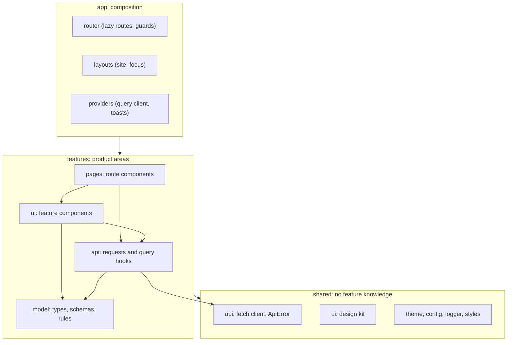
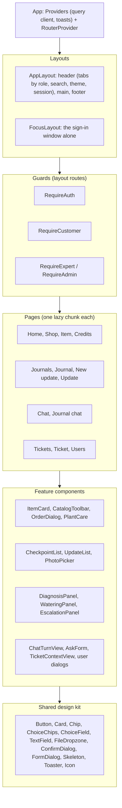
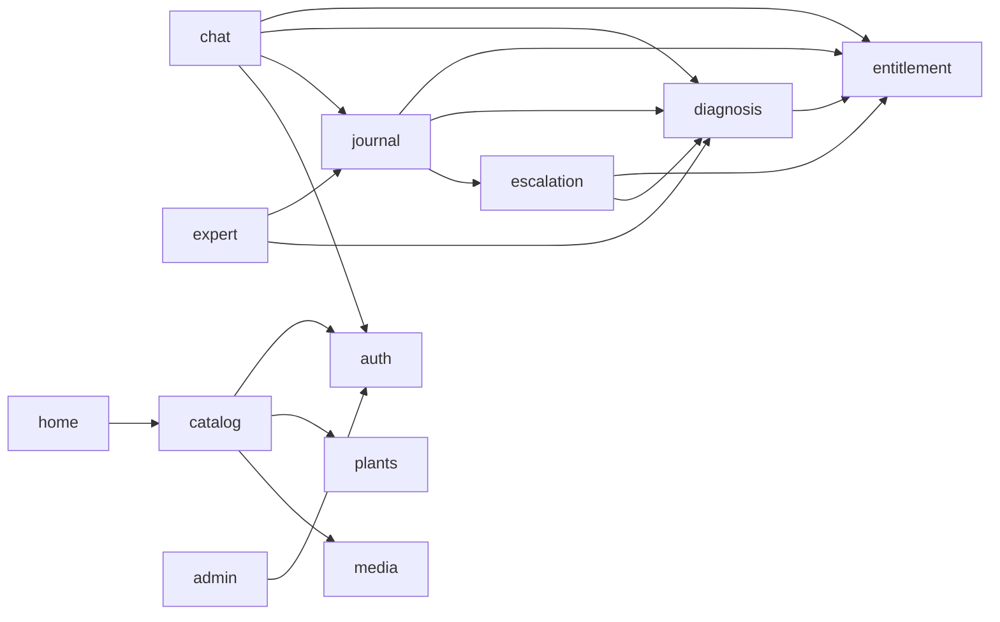

# Architecture and approach

This document covers two parts of the assessment: the architecture scheme (modules, components, routes, state)
and the description of the approach.

## 1. Architecture scheme

### Layers

The code is split by product area (feature modules). Inside every feature the same four slices repeat, so a
reader always knows where a kind of code lives. Shared code has no knowledge of any feature, and `app` is the
only place that wires features together.

Rules the code follows:

- A component never calls `fetch`. Requests live in `api/` and are reached through hooks.
- Business rules that are not tied to React (filtering, price formatting, quota wording, context parsing) live in
  `model/` as pure functions with unit tests.
- `shared/` imports nothing from `features/` or `app/`.

### Components

How a screen is put together: the application shell wires providers and the router; a layout frames every page; a page
(route component) fetches through hooks and composes feature components, which are built from the shared design kit.

### Feature modules

| Module        | Responsibility                                       | Main pieces                                                                          |
| ------------- | ---------------------------------------------------- | ------------------------------------------------------------------------------------ |
| `auth`        | Cognito sign-in, session, role, route guards         | `LoginPage`, `session-store`, `useRole` (`GET /v1/me`), `RequireAuth`, `RequireRole` |
| `catalog`     | Shop: list, item page, search, filter, sort, order   | `CatalogPage`, `ItemPage`, `ItemCard`, `CatalogToolbar`, `OrderDialog`               |
| `admin`       | Administrator: list, create, role, disable, password | `UsersPage`, `CreateUserDialog`, `ChangeRoleDialog`, `PasswordDialog`                |
| `plants`      | Care information of a plant (open, no token)         | `PlantCare`, `usePlant`, `care-blocks` rules                                         |
| `media`       | Item pictures: credits list, captions, credits page  | `CreditsPage`, `useMediaCredits`, `photoCaption`                                     |
| `home`        | Landing page with a few shop items                   | `HomePage`                                                                           |
| `journal`     | Journals, checkpoints, updates, photo upload         | `JournalsPage`, `JournalPage`, `NewUpdatePage`, `UpdatePage`, `PhotoSlot`            |
| `diagnosis`   | Diagnosis panel, clarification, retry                | `DiagnosisPanel`, `ClarificationForm`, quota error checks                            |
| `escalation`  | Expert help: availability, confirmation, answer      | `EscalationPanel`, `expertAvailability`                                              |
| `entitlement` | Tier and quotas, shown next to every spending action | `useEntitlement`, `QuotaSummary`, tier rules                                         |
| `chat`        | Care chat inside a journal                           | `JournalChatPage`, `ChatTurnView`, `AskForm`                                         |
| `expert`      | Expert view: queue, ticket, one written answer       | `TicketsPage`, `TicketPage`, `ticket-context` parser                                 |
| `not-found`   | Unknown address                                      | `NotFoundPage`                                                                       |

Dependencies between modules are explicit imports of another module's `api`, `model` or `ui`:

`entitlement` and `auth` are the bottom layer: they depend on nothing but `shared`. The arrows point from the
dependent module to the one it uses, and there are no cycles.

### Routes

| Address                                  | Page                                                     | Access                           | Layout                       |
| ---------------------------------------- | -------------------------------------------------------- | -------------------------------- | ---------------------------- |
| `/`                                      | Home                                                     | public                           | site                         |
| `/shop`                                  | Shop (filters are kept in the address: `?q=`, `?label=`) | public to read, sign-in to order | site                         |
| `/shop/:slug`                            | Item page: picture, price, order, care information       | public to read, sign-in to order | site                         |
| `/credits`                               | Photo credits and data licence                           | public                           | site                         |
| `/chat`                                  | Pick a journal to ask about                              | signed in                        | site                         |
| `/login`                                 | Sign-in window                                           | public                           | focus (no header, no footer) |
| `/journals`                              | Journals list                                            | signed in                        | site                         |
| `/journals/:journalId`                   | Journal: planting, checkpoints, updates                  | signed in                        | site                         |
| `/journals/:journalId/chat`              | Care chat of the journal                                 | signed in                        | site                         |
| `/journals/:journalId/updates/new`       | New update with photos                                   | signed in                        | site                         |
| `/journals/:journalId/updates/:updateId` | Update: answers, photos, diagnosis, expert help          | signed in                        | site                         |
| `/admin/users`                           | Users: list, create, change role, disable, set password  | role `admin`                     | site                         |
| `/expert/tickets`                        | Open tickets                                             | group `experts`                  | site                         |
| `/expert/tickets/:ticketId`              | Ticket and answer                                        | group `experts`                  | site                         |
| `*`                                      | Not found                                                | public                           | site                         |

Every page is a lazy route (`React.lazy` through the router's `lazy`), so the first load carries only the shell
and the page that was asked for. Guards are layout routes: `RequireAuth` redirects a visitor to `/login` and
remembers the address to come back to; `RequireExpert` and `RequireAdmin` show a "no access" message to a signed-in user of another role. The role comes from `GET /v1/me`, not from the groups in the token (the groups are only a fallback while `/v1/me` cannot be had). Experts and administrators have no shop, chat or journals: `RequireCustomer` sends them from the home page to their own page.

### State

| Kind                | Where                           | What                                                                                                                                                                                                                                                                                                    |
| ------------------- | ------------------------------- | ------------------------------------------------------------------------------------------------------------------------------------------------------------------------------------------------------------------------------------------------------------------------------------------------------- |
| Server state        | TanStack Query                  | Everything that comes from the API: items, journals, updates, photos, diagnosis, escalation, chat turns, entitlement, tickets. Cached by query key, refetched after the mutations that change it. Polling only where the backend is asynchronous (the journal draft after an order, an open escalation) |
| Global client state | Zustand                         | Three small stores: the session (tokens and the groups read from the ID token, kept in `sessionStorage`), the theme (kept in `localStorage`), the toast queue                                                                                                                                           |
| Local state         | React state and React Hook Form | Form values and errors, open dialogs, the chosen file, shop type and sort. Shop search text and label live in the address so a link or the browser's back button restores them                                                                                                                          |

No Redux is used: the shared state is small (session, theme, toasts) and everything else is server data, which
TanStack Query already caches and invalidates. See [stack justification](stack.md).

### Design kit

Colours, spacing, radii and fonts are CSS custom properties in `src/shared/styles/tokens.css`, with a light
and a dark set. Components are styled with CSS Modules that read only those tokens; there are no inline styles (the skeleton's sizes are named classes of the kit). The shared components (`Button`, `Card`, `Chip`, `TextField`,
`ChoiceChips`, `ChoiceField`, `TextAreaField`, `FileDropzone`, `CheckboxGroup` and `RadioGroup` for the shop filter panel, `ConfirmDialog`, `FormDialog`, `Toaster`, `Skeleton`, `ThemeToggle`, `Icon`) are used by every
feature.

## 2. Approach

**Component-based, feature-first.** The application is organised around what the user does (shop, journal,
diagnose, ask an expert), not around technical layers across the whole project. This keeps a change local to
one folder and makes the lazy loading boundaries obvious.

**Typed contract with the backend.** The types of every request and response are generated from the backend's
OpenAPI files (`npm run gen:api`), so a change in the contract becomes a compile error instead of a runtime
surprise. Fields the contract leaves open (the ticket `context`) are read through a defensive parser with its
own schema and tests.

**One place for the network.** All gateway calls go through a single fetch client that adds the ID token,
resolves relative `/v1/...` paths against the page origin and turns every failure into an `ApiError`. Calls to
object storage (the presigned photo upload) and to Cognito are the only other network code, and each is a
single small function.

**Errors are handled once, close to the source.** The client maps problem+json and the gateway's own error
format to one error type with a kind (`unauthorized`, `forbidden`, `not-found`, `conflict`, `validation`,
`unavailable`, `server`, `network`). A global handler on the query and mutation caches logs the failure with
its correlation id and shows a toast. Forms and panels that need to explain the error themselves opt out of the
toast and render it next to the control. A route that fails to render shows an error page instead of a blank
screen. See [API client](api.md) for the full table.

**Validation at the edge.** Every form uses React Hook Form with a Zod schema, shows the message under the field
and marks the control `aria-invalid`. Files are checked (type and size) before they are uploaded.

**Spending is always the user's decision.** The remaining AI checks are shown beside the action that spends one,
and the expert quota is spent only after an explicit confirmation dialog. A user without an expert quota sees
why and which plan changes that, instead of an error after a click.

**Accessible and themeable by construction.** Native elements first (`<dialog>`, `
`, `<form>`,
`<label>`), visible focus, contrast checked in both themes, `prefers-reduced-motion` respected. axe-core
reports no WCAG 2.1 AA violations on the main pages in both themes. The built application also runs under a strict
content security policy (see [security](security.md)).

## 3. Advanced directions (for the maximum grade)

| Direction             | What is done                                                                                                                                                                                                                                            |
| --------------------- | ------------------------------------------------------------------------------------------------------------------------------------------------------------------------------------------------------------------------------------------------------- |
| Advanced architecture | Feature modules with a fixed slice layout, every page lazy-loaded, an explicit and acyclic dependency graph between modules, shared code with no feature knowledge                                                                                      |
| Performance           | Lazy routes and a separate validation chunk, bundled fonts and 4:5 pictures with reserved space and priorities, no layout shifts, Lighthouse 91 to 100 on mobile and desktop (see [performance](performance.md)), checked by a script in the repository |
| UI/UX                 | Own design kit on design tokens, light and dark themes with a remembered choice, WCAG 2.1 AA (labels, ARIA, keyboard, focus, contrast), responsive layout, loading skeletons, deliberate empty and error states                                         |
