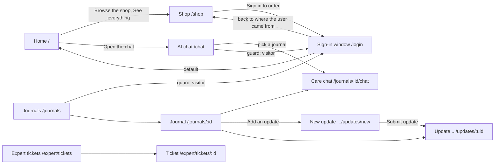
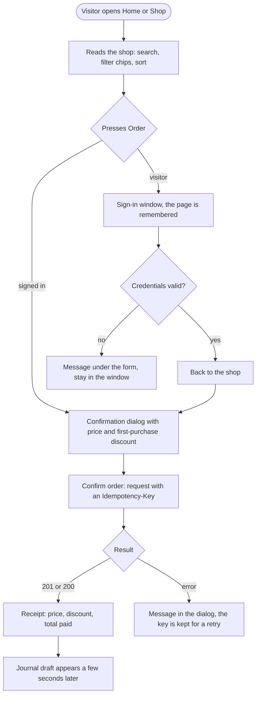
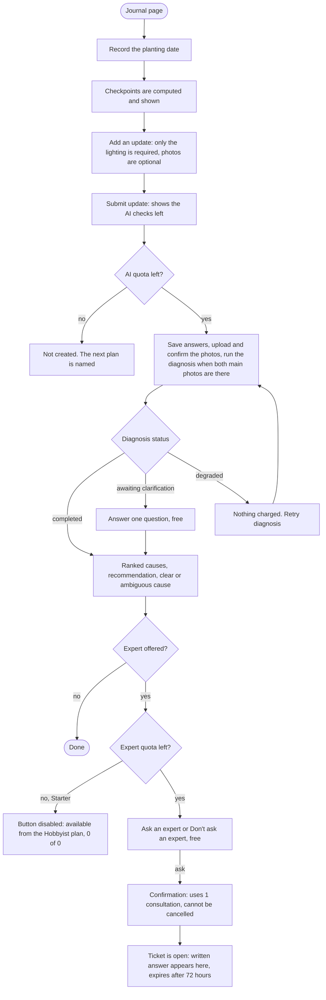
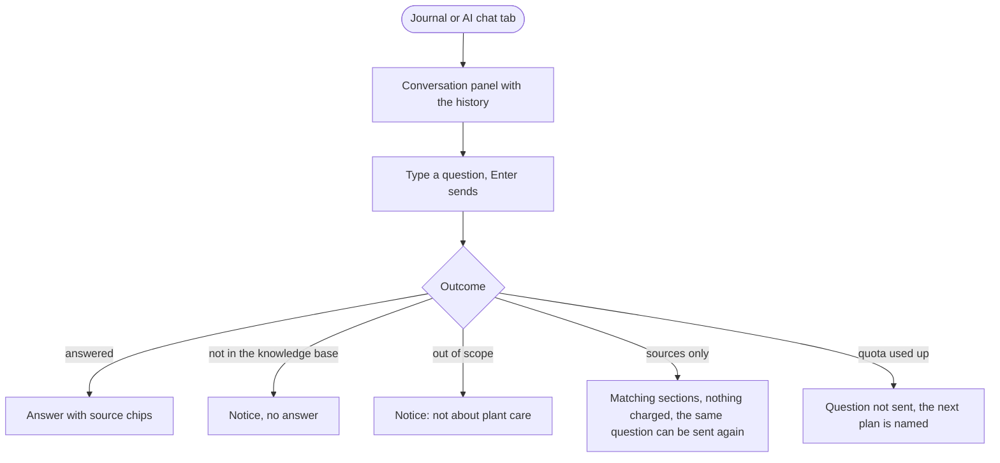
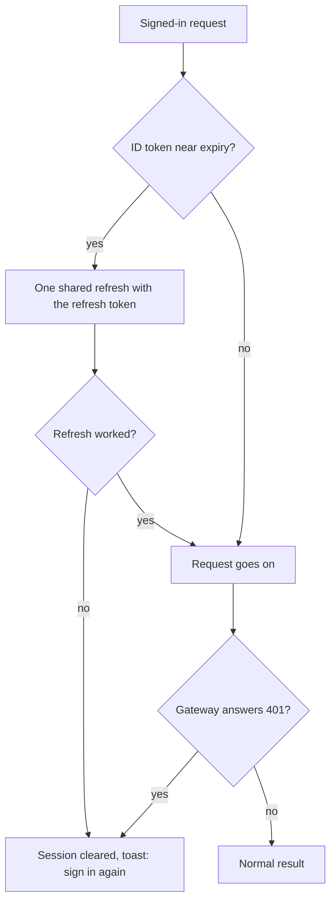

# User flows and navigation

## Navigation map

The header has the same tabs on every page (Home, Shop, AI chat, Journals, and Expert tickets for experts), a
search box, the theme toggle and Sign in or Sign out. The sign-in page is a separate window with no header
and no footer.

Guards: `/chat` and `/journals/*` need a signed-in user and redirect a visitor straight to the sign-in window, remembering the page.
`/expert/tickets/*` need the `experts` group; a signed-in user outside it sees a "no access" message.

## Flow 1: from a visitor to an order

The backend creates the journal draft asynchronously after an order, so the journals page polls for up to a
minute and says that the journal is on its way.

## Flow 2: update, diagnosis and expert help

A diagnosis that asks for a photo of the roots adds that photo slot on the update page.

## Flow 3: care chat

## Flow 4: expert

## Flow 5: session

