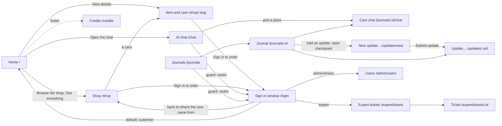
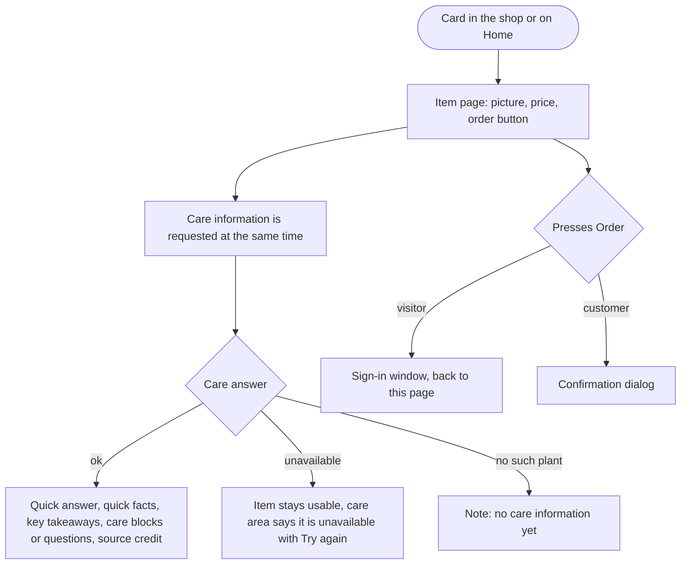
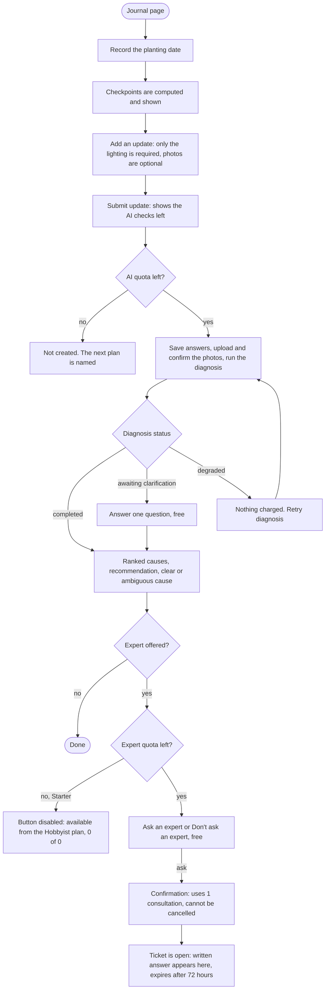
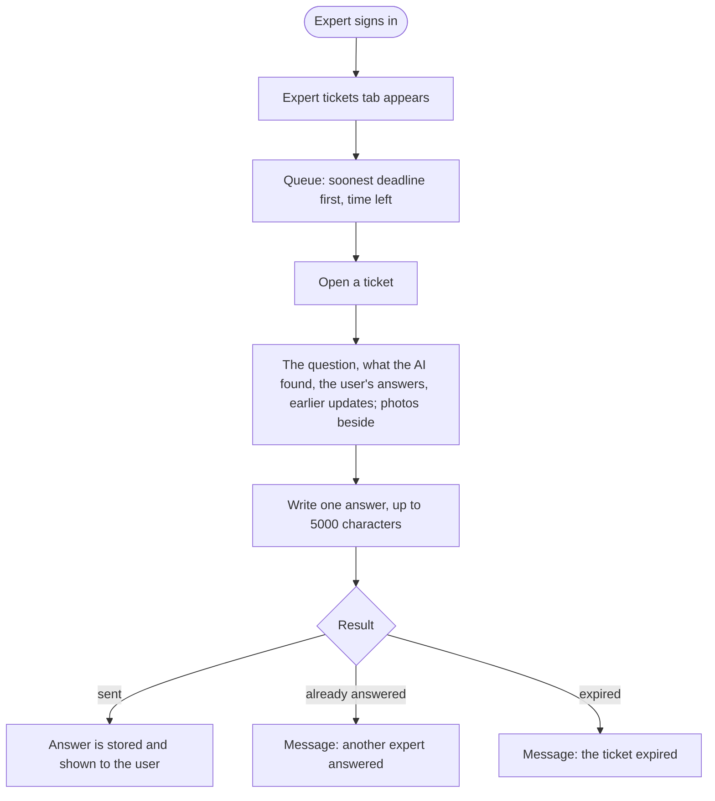
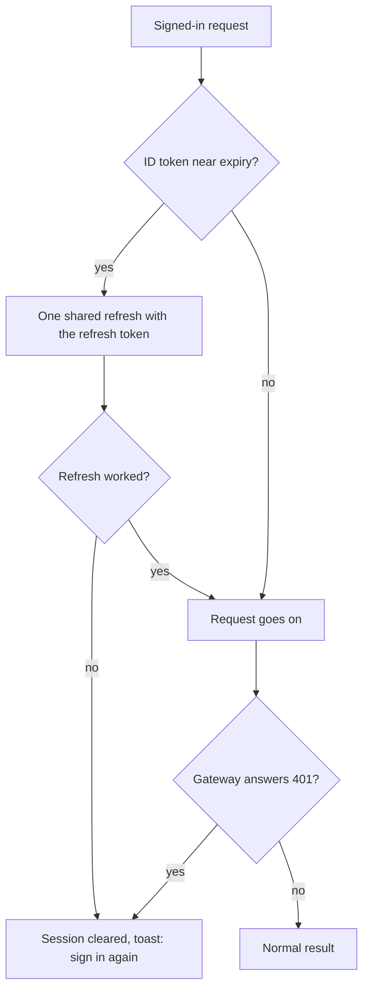
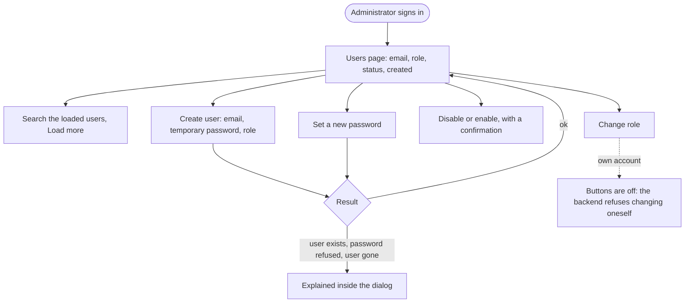

# User flows and navigation

## Navigation map

The header shows tabs that depend on the role. A visitor or a customer sees Home, Shop, AI chat and Journals; an expert
sees only Expert tickets; an administrator sees only Users. Every page also has a search box (customers only), the theme
toggle and Sign in or Sign out. The sign-in page is a separate window with no header and no footer.



Guards (the role comes from `GET /v1/me`):

- `/chat` and `/journals/*` need a signed-in customer; a visitor goes straight to the sign-in window, remembering the page.
- `/expert/tickets/*` are for experts only and `/admin/users` for administrators only; anyone else sees a "no access" page.
- Experts and administrators have no shop, chat or journals: those pages answer "no access" and the home page sends them to
  their own start page.

## Plant page



## Flow 1: from a visitor to an order

```mermaid
flowchart TD
  A([Visitor opens Home or Shop]) --> B[Reads the shop: search, filter panel (type and need checkboxes), sort]
  B --> C{Presses Order}
  C -->|signed in| D[Confirmation dialog with price and first-purchase discount]
  C -->|visitor| E[Sign-in window, the page is remembered]
  E --> F{Credentials valid?}
  F -->|no| G[Message under the form, stay in the window]
  F -->|yes| H[Back to the shop]
  H --> D
  D --> I[Confirm order: request with an Idempotency-Key]
  I --> J{Result}
  J -->|201 or 200| K[Receipt: price, discount, total paid]
  J -->|error| L[Message in the dialog, the key is kept for a retry]
  K --> M[Journal draft appears a few seconds later]
```

The backend creates the journal draft asynchronously after an order, so the journals page polls for up to a
minute and says that the journal is on its way.

## Flow 2: update, diagnosis and expert help



A diagnosis that asks for a photo of the roots adds that photo slot on the update page.

## Flow 3: care chat


## Flow 4: expert



## Flow 5: session



## Flow 6: administrator


